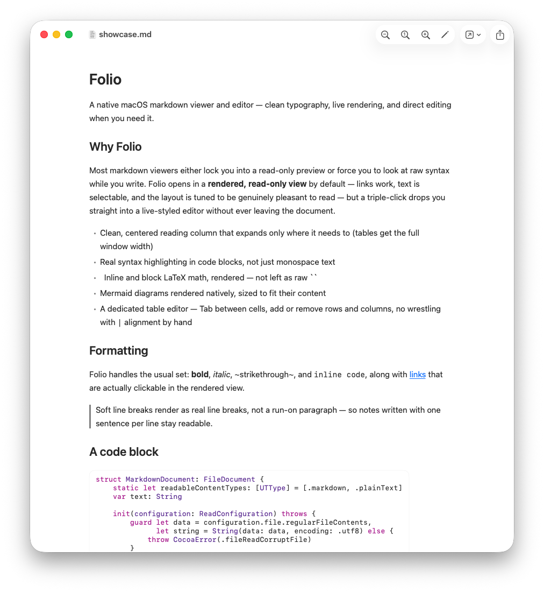

# folio

A native macOS markdown viewer and editor — clean typography, live rendering, and direct editing when you need it.

| View mode | Edit mode |
| --- | --- |
|  |  |

## Why Folio

Most markdown viewers either lock you into a read-only preview or force you to look at raw syntax while you write. Folio opens in a **rendered, read-only view** by default — links work, text is selectable, and the layout is tuned to be genuinely pleasant to read — but a triple-click drops you straight into a live-styled editor without ever leaving the document.

- Clean, centered reading column that expands only where it needs to (tables get the full window width)
- Real syntax highlighting in code blocks, not just monospace text
- Inline and block LaTeX math, rendered — not left as raw `$...$`
- Mermaid diagrams rendered natively, sized to fit their content
- A dedicated table editor — Tab between cells, add or remove rows and columns, no wrestling with `|` alignment by hand
- Open the current file directly in Xcode, VS Code, or TextEdit from the toolbar
- Share the actual document from the toolbar, not a text snippet

## Requirements

- macOS 14+
- [XcodeGen](https://github.com/yonaskolb/XcodeGen) to generate the Xcode project (`brew install xcodegen`)

## Building

```
xcodegen generate
open Folio.xcodeproj
```

The project uses Xcode's synced folder groups, so new files added under `Folio/` show up in Xcode automatically — you only need to re-run `xcodegen generate` after changing `project.yml` itself (build settings, dependencies, and so on).

## Releasing

```
scripts/release.sh v0.1.0
```

Archives a Release build, ad-hoc signs it, packages it as a DMG, and publishes a GitHub release via `gh`.

---

Inspired by [Glance](https://glance.md/).
